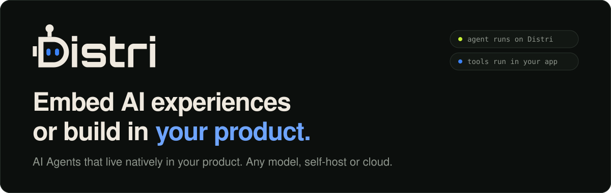

<p align="center">
  
</p>

<p align="center">
  <a href="https://distri.dev/docs/"><b>Docs</b></a> ·
  <a href="https://distri.dev/samples/"><b>Live samples</b></a> ·
  <a href="https://distri.dev/"><b>Website</b></a> ·
  <a href="https://app.distri.dev"><b>Distri Cloud</b></a>
</p>

<p align="center">
  <a href="LICENSE"></a>
  <a href="https://github.com/distrihub/distri/releases"></a>
  
  
</p>

<h3 align="center">AI Agents that live natively in your product.</h3>

Distri is an open-source (MIT) agent server written in Rust. An agent is a markdown file; Distri runs it on any model, on your own server or on [Distri Cloud](https://app.distri.dev), and exposes it as an [A2A 1.0](https://a2a-protocol.org/) endpoint your product, your backend or a chat app can call.

## Three ways to use it

| | What you get | Where |
|---|---|---|
| **Embed AI experiences** | A chat UI in your app whose agent calls your app's own functions (`cart.add`, `form.setValues`) in the signed-in user's browser or phone. | [`@distri/react`](https://www.npmjs.com/package/@distri/react), [`@distri/react-native`](https://www.npmjs.com/package/@distri/react-native), [`@distri/angular`](https://www.npmjs.com/package/@distri/angular) ([distrijs](https://github.com/distrihub/distrijs)), or one `<script src="https://embed.distri.dev/v1/embed.js">` tag on Distri Cloud |
| **Bots and channels** | The same agent answers in Telegram, WhatsApp and Discord, with alerts from scheduled workflows. | Distri Cloud |
| **Build agents in your product** | Agents and workflows your backend calls over A2A; tools over MCP and HTTP; 11 provider types; usage and cost per agent (per customer on Distri Cloud). | This repository, self-hosted, or Distri Cloud |

<table>
  <tr>
    <td width="50%"><a href="https://distri.dev/samples/?id=kyb-onboarding"></a></td>
    <td width="50%"><a href="https://distri.dev/samples/?id=checkout"></a></td>
  </tr>
  <tr>
    <td align="center"><b>KYC / KYB</b><br>Reads two documents and fills the whole form.</td>
    <td align="center"><b>Checkout</b><br>One sentence becomes a cart, a discount and a ready-to-pay sheet.</td>
  </tr>
</table>

Live: [distri.dev/samples](https://distri.dev/samples/). Blueprints that set up an agent, its workflows and its channel from one sentence: [`samples/`](samples) (`distri apply samples/sre-agent`).

## Quickstart (self-hosted, no API key)

Needs Rust and [Ollama](https://ollama.com); the model runs locally, so no key is needed.

```bash
git clone https://github.com/distrihub/distri && cd distri
cargo build -p distri-cli -p distri-server-cli --features distri-server-cli/sqlite_vendored
./target/debug/distri-server --headless &      # listens on http://127.0.0.1:8081/v1
ollama pull qwen3:4b
```

Write an agent:

```bash
mkdir -p agents && cat > agents/greeter.md <<'MD'
---
name = "greeter"
description = "Answers in one short sentence"

[model_settings]
model = "qwen3:4b"

[model_settings.provider]
name = "openai_compat"
base_url = "http://127.0.0.1:11434/v1"
api_key = "ollama"
---

Answer in one short sentence. /no_think
MD
```

Push it and send it a message:

```bash
export DISTRI_BASE_URL=http://127.0.0.1:8081/v1
./target/debug/distri push
#   Pushed agent 'greeter'

curl -s $DISTRI_BASE_URL/agents/greeter -H 'Content-Type: application/json' -d '{
  "jsonrpc": "2.0", "id": "1", "method": "SendMessage",
  "params": {"message": {"messageId": "m-1", "role": "ROLE_USER",
                         "parts": [{"text": "What is the capital of France?"}]}}}'
```

```json
{"jsonrpc": "2.0", "id": "1", "result": {"task": {
  "id": "f4bb01ef-ba78-429f-a929-b10c4209f967",
  "contextId": "d566bd02-af53-4ed3-b47c-a3f12a83f027",
  "status": {"state": "TASK_STATE_COMPLETED", "timestamp": "2026-11-20T19:39:18.099Z",
    "message": {"role": "ROLE_AGENT", "parts": [{"text": "Paris"}], "metadata": {"is_final": true, "message_type": "text"}, …}}}}}
```

To use a hosted model instead, start the server with the provider's key in its environment and change the provider block:

```bash
export OPENAI_API_KEY=sk-...                     # read by distri-server
```

```toml
[model_settings]
model = "gpt-4.1-mini"

[model_settings.provider]
name = "openai"
```

The other provider names are under [Models](#models).

On a 16-core CPU with no GPU, qwen3:4b took 10 minutes to send that reply; use a hosted model or a GPU for anything past this check. `/no_think` turns off Qwen3's reasoning.

More: [streaming, tasks and the CLI](docs/cli.md), the agent card at `/v1/agents/greeter/.well-known/agent-card.json`, and [distri's A2A extensions](docs/a2a-extensions/README.md).

## Embed it in a React app

```tsx
import { DistriProvider, Chat } from '@distri/react';
import type { DistriFnTool } from '@distri/core';

const addToCart: DistriFnTool = {
  name: 'add_to_cart',
  description: 'Add a product to the cart',
  type: 'function',
  parameters: { type: 'object', properties: { sku: { type: 'string' } }, required: ['sku'] },
  autoExecute: true,
  handler: async ({ sku }) => {
    await cart.add(sku); // your code, in the user's browser
    return { ok: true, items: cart.count };
  },
};

export const App = ({ threadId }: { threadId: string }) => ( // one id per conversation
  <DistriProvider config={{ baseUrl: 'https://api.distri.dev/v1', clientId: 'dpc_…', workspaceId: '…' }}>
    <Chat agentId="shop_agent" threadId={threadId} externalTools={[addToCart]} />
  </DistriProvider>
);
```

The agent lists `add_to_cart` under `[tools] external`; when it calls it, the handler runs in the page and the cart changes the way it does for a click. The snippet typechecks against `@distri/react` 0.4.6 from npm. Guide: [in-product tools](https://distri.dev/docs/guides/agent/in-product-tools/).

## Compared with

From each project's own docs, 2026-11-20.

| | Distri | Claude Managed Agents | OpenAI Agents SDK | Vercel AI SDK |
|---|---|---|---|---|
| Licence | MIT | No public source | MIT | Apache-2.0 |
| Models | 11 provider types, any OpenAI-compatible endpoint | Claude | OpenAI plus 100+ other LLMs | Provider packages |
| What it is | Agent server, UI SDKs, channels | Hosted agent API (self-hosted server through Anthropic sales) | Python/TS library | TypeScript library |
| Price | Free to self-host | Tokens plus $0.08 per session-hour | Free library | Free library |

OpenAI's Agent Builder shuts down on 2026-11-30 ([deprecations](https://developers.openai.com/api/docs/deprecations)).

## Models

Set the model per agent in `[model_settings]`. Provider `name` values: `openai`, `anthropic`, `gemini`, `azure_openai`, `azure_ai_foundry`, `aws_bedrock`, `google_vertex`, `alibaba_cloud` (Qwen), `zai` (GLM), `fal_ai` (images) and `openai_compat` (Ollama, vLLM, OpenRouter, Together, Groq, any OpenAI-compatible URL). The model catalog is [`distri-types/src/default_models.json`](distri-types/src/default_models.json).

## Install the CLI

```bash
curl -fsSL https://distri.dev/install.sh | sh    # macOS and Linux, from GitHub releases
distri login                                      # Distri Cloud
```

<details>
<summary><b>Repository layout</b></summary>

```
distri/
├── distri-types/          # Shared types (agent config, events, stores, tools)
├── distri-cli/            # The `distri` command
├── distri/                # Rust client library (A2A)
├── distri-a2a/            # A2A protocol types
├── distri-workflow/       # Workflow definitions
├── distri-tool/           # TypeScript script-tool contract (Deno)
├── samples/               # Blueprints for `distri apply`
└── server/
    ├── distri-core/       # Agent loop, tools, model clients
    ├── distri-server/     # HTTP server (actix-web, A2A endpoints)
    ├── distri-server-cli/ # The `distri-server` binary
    ├── distri-stores/     # SQLite and Postgres stores
    ├── distri-auth/       # Auth and OAuth connections
    ├── distri-filesystem/ # File and artifact tools
    ├── llm-gateway/       # Provider clients
    └── agents/            # Built-in agent definitions
```

</details>

## License

[MIT](LICENSE)
