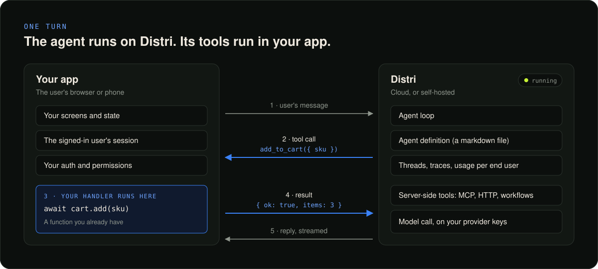
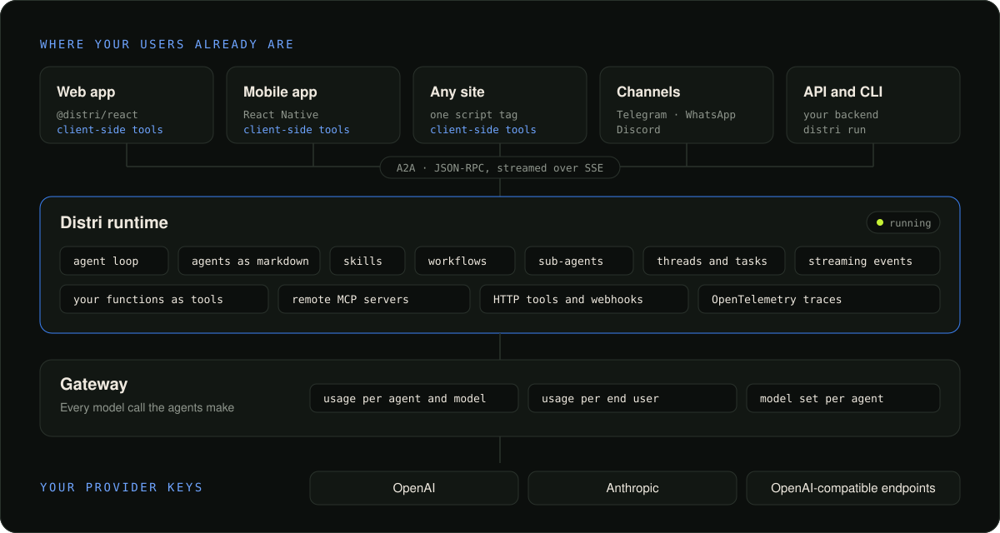

<p align="center">
  
</p>

<p align="center">
  <a href="https://distri.dev/docs/"><b>Documentation</b></a> ·
  <a href="https://distri.dev/samples"><b>Gallery</b></a> ·
  <a href="https://distri.dev/"><b>Website</b></a> ·
  <a href="https://app.distri.dev"><b>Distri Cloud</b></a>
</p>

Distri puts an agent inside your product, for the people who use it.

Distri runs the agent. The agent works through what your product already has: its screens, its functions, its APIs, its auth and the signed-in user's session. You don't rebuild any of that for the agent, and your users don't leave your product to use it.

## How it works



**The agent runs on Distri. Its tools run in your app.**

1. An agent is a markdown file: instructions, a model and a list of tools.
2. In your frontend you hand the chat component the functions the agent may call. These are functions you already have, such as `cart.add` or `form.setValues`.
3. When the agent calls one, Distri sends the call to the user's browser or phone. Your handler runs there, with that user's session and permissions, and the result goes back to the agent.
4. A tool can run on its own, or wait for the user to approve or decline it in your UI.

The agent can also call server-side tools: remote MCP servers, declarative HTTP tools and sub-agents.

## Quick start

Install the CLI:

```bash
curl -fsSL https://distri.dev/install.sh | sh
# or: brew tap distrihub/distri && brew install distri
```

### 1. Write the agent and push it

`agents/shop_assistant.md`:

```markdown
---
name = "shop_assistant"
description = "Helps shoppers check out"

[tools]
external = ["add_to_cart"]

[model_settings]
model = "gpt-4.1-mini"
---

# ROLE
You help shoppers on our store.
```

```bash
distri login   # Distri Cloud; skip this when you self-host
distri push    # syncs ./agents, ./skills and ./templates to your workspace
```

### 2. Hand it your functions

```bash
npm install @distri/react @distri/core
```

```tsx
import '@distri/react/styles.css';
import { useMemo } from 'react';
import { DistriProvider, Chat } from '@distri/react';
import type { DistriFnTool } from '@distri/core';
import { useCart } from './cart';

export function ShopAssistant() {
  const cart = useCart(); // your state, as it is

  const tools = useMemo<DistriFnTool[]>(() => [{
    name: 'add_to_cart',
    description: 'Add a product to the cart',
    type: 'function',
    parameters: {
      type: 'object',
      properties: { sku: { type: 'string' }, qty: { type: 'number' } },
      required: ['sku'],
    },
    autoExecute: true, // leave out to ask the user first
    handler: async ({ sku, qty = 1 }) => {
      await cart.add(sku, qty); // runs in the browser
      return { ok: true, items: cart.count };
    },
  }], [cart]);

  return (
    <DistriProvider config={{
      baseUrl: 'https://api.distri.dev/v1', // or your own server, e.g. http://localhost:7777
      clientId: 'dpc_…',
      workspaceId: '…',
    }}>
      <Chat agentId="shop_assistant" externalTools={tools} />
    </DistriProvider>
  );
}
```

### 3. Use it

Ask the assistant to add something to the cart. The call to `add_to_cart` crosses to the browser, your handler runs, and the cart on screen changes.

The [Gallery](https://distri.dev/samples) has four products driven this way (a checkout, KYC/KYB onboarding, a design canvas and a 3D studio), each with its tools and agent file.

The TypeScript SDK (`@distri/core`, `@distri/react`, React Native, Angular) lives in [distrihub/distrijs](https://github.com/distrihub/distrijs). See the [in-product tools guide](https://distri.dev/docs/guides/agent/in-product-tools/).

## What's in the box



| | |
|---|---|
| **Agents as markdown** | Instructions, model settings and tools in one `.md` file with TOML frontmatter. [Agent definition](https://distri.dev/docs/concepts/agent-definition) |
| **Client-side tools** | Functions in your app that the agent calls. They run in the user's browser or phone. |
| **Approve or decline** | Leave `autoExecute` off and the chat asks the user before the handler runs. |
| **Server-side tools** | Remote MCP servers, declarative HTTP tools, and built-ins such as `search`, `load_skill` and `invoke_agent`. |
| **Skills** | Instruction documents an agent loads on demand with `load_skill`. They are re-injected after context compaction. |
| **Sub-agents** | An agent can delegate to a named or ad-hoc worker, in the foreground or background. |
| **Workflows** | Fixed sequences of tool calls, agent runs, conditions and a `wait_for_input` step that pauses for a person. |
| **Streaming and resume** | Typed events over SSE. A client that reconnects replays the task's history and then continues live. |
| **Traces and usage** | OpenTelemetry spans for agent, step, model call and tool, and a usage record for every model call. |
| **Open protocols** | Every agent is reachable over [A2A](https://google.github.io/a2a/) (JSON-RPC). Tools connect over MCP. |

## The same agent, wherever the work continues

The agent you embed in your app is an API endpoint, so it can answer anywhere your users or your systems are.

- **In your product:** web with `@distri/react`, mobile with React Native, or any site with one script tag.
- **On chat channels:** Telegram, WhatsApp and Discord bots are built into [Distri Cloud](https://app.distri.dev). Paste a bot token and pick the agent or workflow it runs.
- **Slack and your other systems:** call the agent from a webhook, a workflow or your backend through the API.
- **From a terminal or a script:** `distri run` and `distri tui`.

## Models

The model is set per agent, on your own provider keys.

- **Native wire formats:** OpenAI Chat Completions, OpenAI Responses and Anthropic Messages.
- **Everything else** connects through an OpenAI-compatible endpoint, including Gemini, Azure OpenAI and open models served that way. Which features work depends on the endpoint and the model.

## Self-host or use Distri Cloud

**Self-host.** One command starts the server and the web UI on SQLite:

```bash
distri serve            # http://localhost:7777
distri serve --no-ui    # API only
distri serve --port 8080
```

The first run downloads the matching `distri-server` binary and UI bundle from [Releases](https://github.com/distrihub/distri/releases) into `~/.distri/`. Postgres is supported for larger deployments. The self-hosted server is single-tenant.

**Distri Cloud** adds workspaces and members, bots on chat channels, schedule and webhook triggers for workflows, usage and limits per end user, and stored traces. [app.distri.dev](https://app.distri.dev)

Two things to know before you self-host:

- The `search`, shell, code-execution and browser tools are clients of the [Browsr](https://browsr.dev) service and need `BROWSR_BASE_URL` and `BROWSR_API_KEY`.
- Approvals for client-side tools are shown in your own UI by the client SDK.

## CLI

```bash
distri                                   # interactive TUI
distri tui my_agent                      # chat with one agent
distri run --agent my_agent --task "…"   # run a single task
distri run --agent my_agent --task "…" --tag team=growth

distri push                              # sync agents, skills and templates
distri push --dry-run                    # preview what would upload
distri agents list
distri skills list
distri traces list                       # inspect runs
distri secrets list
distri connections list

distri update                            # pull the latest server and UI
distri version
```

<details>
<summary>Other install options</summary>

**Direct download:**
```bash
# darwin-arm64 | darwin-x86_64 | linux-arm64 | linux-x86_64
TARGET=darwin-arm64
curl -L "https://github.com/distrihub/distri/releases/latest/download/distri-${TARGET}.tar.gz" -o distri.tar.gz
sudo tar -xzf distri.tar.gz -C /usr/local/bin distri
```

**Windows (PowerShell):**
```powershell
Invoke-WebRequest https://github.com/distrihub/distri/releases/latest/download/distri-windows-x86_64.zip -OutFile distri.zip
Expand-Archive distri.zip -DestinationPath $Env:LOCALAPPDATA\distri -Force
$Env:Path += ";$Env:LOCALAPPDATA\distri"
```
</details>

## Repository layout

```
distri/
├── distri-types/          # Shared types (agent config, events, stores, tools)
├── distri-cli/            # The `distri` command
├── distri/                # Rust client library (A2A)
├── distri-a2a/            # A2A protocol types
├── distri-workflow/       # Workflow definitions
├── distri-tool/           # TypeScript script-tool contract (Deno)
└── server/
    ├── distri-core/       # Agent loop, tools, model clients
    ├── distri-server/     # HTTP server (actix-web, A2A endpoints)
    ├── distri-stores/     # SQLite and Postgres stores
    ├── distri-auth/       # Auth and OAuth connections
    ├── distri-filesystem/ # File and artifact tools
    ├── llm-gateway/       # Provider clients
    └── agents/            # Built-in agent definitions
```

## Development

```bash
cargo build
cargo test
cargo test -p distri-core
```

---

## License

[MIT License](LICENSE)

---

## Links

- [Documentation](https://distri.dev/docs/)
- [Gallery](https://distri.dev/samples)
- [Distri Cloud](https://app.distri.dev)
- [Releases](https://github.com/distrihub/distri/releases)
- [Issues](https://github.com/distrihub/distri/issues)
