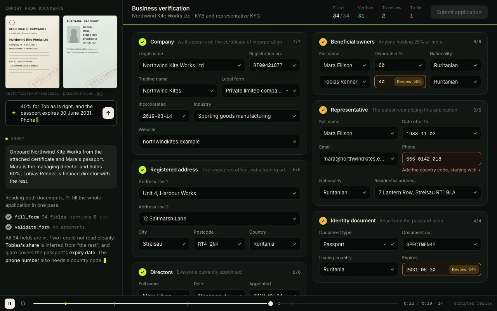
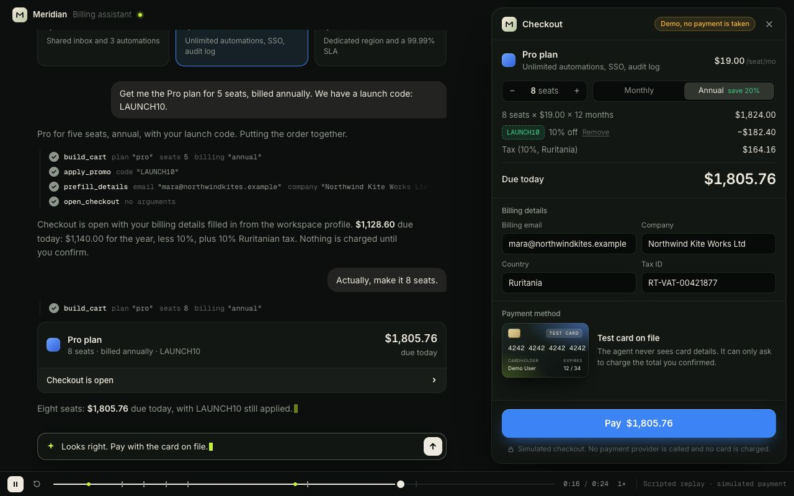
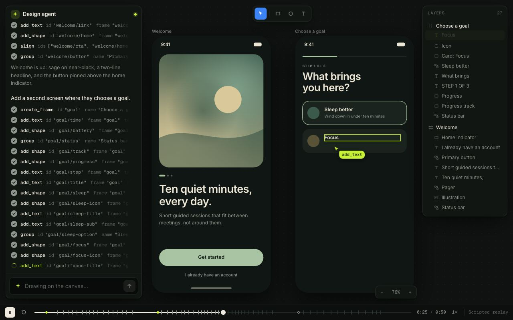
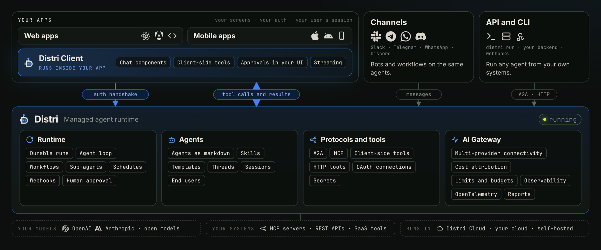

<p align="center">
  
</p>

<p align="center">
  <a href="https://distri.dev/docs/"><b>Docs</b></a> ·
  <a href="https://distri.dev/samples/"><b>Live samples</b></a> ·
  <a href="https://distri.dev/"><b>Website</b></a> ·
  <a href="https://app.distri.dev"><b>Distri Cloud</b></a>
</p>

<p align="center">
  <a href="LICENSE"></a>
  <a href="https://github.com/distrihub/distri/releases"></a>
  
  
</p>

<h3 align="center">Powering AI-native experiences with a managed agents platform.</h3>

<p align="center">
Coding agents have transformed the software industry.<br>
Distri brings those agentic capabilities, embedded directly in your product.
</p>

<br>

<table>
  <tr>
    <td width="50%"><a href="https://distri.dev/samples/?id=kyb-onboarding"></a></td>
    <td width="50%"><a href="https://distri.dev/samples/?id=checkout"></a></td>
  </tr>
  <tr>
    <td align="center"><b>KYC / KYB</b><br>Reads two documents and fills the whole form.</td>
    <td align="center"><b>Checkout</b><br>One sentence becomes a cart, a discount and a ready-to-pay sheet.</td>
  </tr>
  <tr>
    <td><a href="https://distri.dev/samples/?id=design-canvas"></a></td>
    <td><a href="https://distri.dev/samples/?id=3d-studio"></a></td>
  </tr>
  <tr>
    <td align="center"><b>Design canvas</b><br>Lays out two mobile screens, then restyles them.</td>
    <td align="center"><b>3D studio</b><br>Builds a model part by part in WebGL.</td>
  </tr>
</table>

<p align="center"><a href="https://distri.dev/samples/"><b>Play them live →</b></a></p>

## An open-source alternative to Claude Managed Agents

Claude Managed Agents runs Claude agents on Anthropic's managed infrastructure. Distri is a managed agents platform you can run anywhere, on any model, and it puts the agent inside your product.

| | Distri | Claude Managed Agents |
|---|---|---|
| **Licence** | Open source, MIT | Proprietary, hosted by Anthropic |
| **Where it runs** | Distri Cloud, your cloud, or fully self-hosted | Anthropic's managed infrastructure |
| **Models** | OpenAI, Anthropic, Gemini, Qwen, GLM and any OpenAI-compatible endpoint | Claude |
| **Where tools run** | In your app, in the signed-in user's session, plus MCP and HTTP tools on the server | In a managed sandbox; custom tools run in your backend |
| **Your UI** | Chat components for React, React Native and Angular, or one script tag | You build the client |
| **Platform fee** | Free | Token rates plus a fee per session-hour |

Distri also tracks identity, cost and limits per end user, and runs the same agents on Slack, Telegram, WhatsApp and Discord.

## How it works

<p align="center">
  
</p>

- **An agent is a markdown file:** instructions, a model and a list of tools.
- **A tool is a function your app already has,** like `cart.add` or `form.setValues`.
- **When the agent calls it, your handler runs in the user's browser or phone,** in their session. The user sees every step and approves what matters.

## Quick start

```bash
curl -fsSL https://distri.dev/install.sh | sh
```

**1. Write the agent and push it**

```markdown
---
name = "shop_assistant"
description = "Helps shoppers check out"

[tools]
external = ["add_to_cart"]

[model_settings]
model = "gpt-4.1-mini"
---

# ROLE
You help shoppers on our store.
```

```bash
distri login
distri push
```

**2. Hand it your functions**

```tsx
import { DistriProvider, Chat } from '@distri/react';
import type { DistriFnTool } from '@distri/core';

const addToCart: DistriFnTool = {
  name: 'add_to_cart',
  description: 'Add a product to the cart',
  type: 'function',
  parameters: { type: 'object', properties: { sku: { type: 'string' } }, required: ['sku'] },
  autoExecute: true,
  handler: async ({ sku }) => {
    await cart.add(sku); // your code, in the browser
    return { ok: true, items: cart.count };
  },
};

<DistriProvider config={{ baseUrl: 'https://api.distri.dev/v1', clientId: 'dpc_…', workspaceId: '…' }}>
  <Chat agentId="shop_assistant" externalTools={[addToCart]} />
</DistriProvider>
```

**3. Ask it something**

> Add two oat milks to my cart

The agent calls `add_to_cart`, your handler runs, and the cart on screen changes the way it does for a click.

Full guide: [in-product tools](https://distri.dev/docs/guides/agent/in-product-tools/). The SDKs for React, React Native and Angular live in [distrihub/distrijs](https://github.com/distrihub/distrijs).

## Call an agent

Every agent is an [A2A 1.0](https://a2a-protocol.org/) JSON-RPC endpoint. Any A2A client
(e.g. a2a-rs's `a2acli`) works unchanged; distri's additions are opt-in
[A2A extensions](docs/a2a-extensions/README.md) a client activates with the `A2A-Extensions` header.

**Send a message**

```bash
curl -X POST https://api.distri.dev/v1/agents/shop_assistant \
  -H "Authorization: Bearer $DISTRI_API_KEY" \
  -H "Content-Type: application/json" \
  -d '{
    "jsonrpc": "2.0",
    "id": "1",
    "method": "SendMessage",
    "params": {
      "message": {
        "messageId": "m-1",
        "role": "ROLE_USER",
        "parts": [{ "text": "What is in my cart?" }]
      }
    }
  }'
```

**Stream the reply** over SSE: use `"method": "SendStreamingMessage"` and `curl -N`. Add
`-H "A2A-Extensions: https://distri.dev/a2a/extensions/event-stream/v1"` for distri's full event
stream. (The A2A 0.x method names, `message/send` …, still work for one release.)

**Self-hosted:** the same calls work against `http://localhost:7777/v1/agents/shop_assistant`.

```bash
curl http://localhost:7777/agents                                          # list agents
curl http://localhost:7777/agents/shop_assistant/.well-known/agent-card.json  # A2A agent card
```

**From the CLI**

```bash
distri run --agent shop_assistant --task "What is in my cart?"   # run one task
distri tui shop_assistant                                        # chat in the terminal
distri push                                                      # sync agents, skills and templates
distri traces list                                               # inspect runs
distri serve                                                     # run the server and UI locally
```

**A2A from the CLI**, by domain (`--agent` defaults to `$DISTRI_AGENT`, else `distri`; `--json`
prints the protocol JSON, one frame per line when streaming; `--extensions` activates A2A
extensions by name or URI, and the ones the server activated are reported on stderr)

```bash
distri agents card shop_assistant [--extended] [--json]          # the public A2A card
distri run --agent shop_assistant --task "…" --json              # SendMessage (waits for the task)
distri run --task "…" --stream [--extensions event-stream]       # SendStreamingMessage: one line per frame
distri run --task "…" --async                                    # print the task id and return
distri run --task "…" --context-id <thread> --task-id <id> --data-part '{"k":1}' --metadata @meta.json
distri tasks get <task_id> [--history 5]                         # GetTask
distri tasks list [--context <thread>] [--state input-required] [--limit 20]   # ListTasks
distri tasks cancel <task_id>                                    # CancelTask
distri tasks subscribe <task_id>                                 # SubscribeToTask (event-stream)
distri tasks push-config list|get|set|delete <task_id> …         # push configs (set --url [--token])
distri tasks pending <task_id>                                   # pending calls (durable-runs extension)
```

`distri run` without those flags is the interactive runner (local tools, terminal rendering); any
of `--json`, `--stream`, `--async`, `--metadata`, `--data-part`, `--extensions` makes it a plain,
non-interactive A2A send.

With durable runs on (`DISTRI_DURABLE_RUNS=1`), the agent card lists the A2A extension
`https://distri.dev/a2a/extensions/durable-runs/v1` in `capabilities.extensions`; its `params`
name the pending-calls and claim endpoints.

## Everything an embedded agent needs, built in

<p align="center">
  
</p>

| | |
|---|---|
| **Distri Client** | Runs inside your app: chat components, client-side tools, approvals in your own UI and streaming. For web, mobile, or any page with one script tag. |
| **Runtime** | Durable runs, workflows, sub-agents, schedules, webhooks and steps that wait for a person. |
| **Agents** | Agents as markdown, skills, templates, threads, sessions and end users. |
| **Protocols and tools** | [A2A](https://google.github.io/a2a/) for every agent, MCP for tools, HTTP tools, OAuth connections and secrets. |
| **AI Gateway** | Multi-provider connectivity, cost attribution per agent and end user, limits and budgets, OpenTelemetry traces. |
| **Channels** | The same agent on Slack, Telegram, WhatsApp and Discord, or from your backend over the API. |

## Providers and models

Set the model per agent. Connect to frontier and open-source models, for text, voice, audio and images.

```toml
[model_settings]
model = "claude-sonnet-4"

[model_settings.provider]
name = "anthropic"
```

| Provider | `name` | Models |
|---|---|---|
| **OpenAI** | `openai` | GPT-6 (Astra, Sol, Luna), GPT-5.6, GPT-5.5, GPT-5.4, GPT-5 mini and nano, GPT-4.1, GPT-4o, o3, o4-mini |
| **Anthropic** | `anthropic` | Claude Opus, Sonnet and Haiku |
| **Google Gemini** | `gemini` | Gemini 2.5 Pro and Flash |
| **Azure OpenAI** | `azure_openai` | Your Azure deployments |
| **Azure AI Foundry** | `azure_ai_foundry` | Models in your Foundry resource |
| **AWS Bedrock** | `aws_bedrock` | Models in your Bedrock account |
| **Google Vertex AI** | `google_vertex` | Models in your Vertex project |
| **Alibaba Cloud** | `alibaba_cloud` | Qwen |
| **Z.ai** | `zai` | GLM |
| **fal.ai** | `fal_ai` | Image models such as FLUX |
| **Any OpenAI-compatible endpoint** | `openai_compat` | Llama, Mistral, DeepSeek and others through Ollama, vLLM, OpenRouter, Together or Groq |

**Voice and audio:** `gpt-4o-mini-tts`, `tts-1` and `tts-1-hd` for speech, `whisper-1` for transcription.
**Images:** `gpt-image-1`, `gpt-image-2` and fal.ai models.

## Run it

**Distri Cloud** is the fastest way to start: [app.distri.dev](https://app.distri.dev).

**Self-host** with one command. It starts the server and the web UI:

```bash
distri serve            # http://localhost:7777
```

<details>
<summary><b>CLI reference</b></summary>

```bash
distri                                   # interactive TUI
distri tui my_agent                      # chat with one agent
distri run --agent my_agent --task "…"   # run a single task

distri push                              # sync agents, skills and templates
distri push --dry-run                    # preview what would upload
distri agents list
distri skills list
distri traces list                       # inspect runs
distri agents card my_agent              # the agent's public A2A card
distri tasks list                        # A2A tasks: list/get/cancel/subscribe/pending
distri secrets list
distri connections list

distri update                            # pull the latest server and UI
distri version
```

</details>

<details>
<summary>Other install options</summary>

**Direct download:**
```bash
# darwin-arm64 | darwin-x86_64 | linux-arm64 | linux-x86_64
TARGET=darwin-arm64
curl -L "https://github.com/distrihub/distri/releases/latest/download/distri-${TARGET}.tar.gz" -o distri.tar.gz
sudo tar -xzf distri.tar.gz -C /usr/local/bin distri
```

**Windows (PowerShell):**
```powershell
Invoke-WebRequest https://github.com/distrihub/distri/releases/latest/download/distri-windows-x86_64.zip -OutFile distri.zip
Expand-Archive distri.zip -DestinationPath $Env:LOCALAPPDATA\distri -Force
$Env:Path += ";$Env:LOCALAPPDATA\distri"
```
</details>

<details>
<summary><b>Repository layout</b></summary>

```
distri/
├── distri-types/          # Shared types (agent config, events, stores, tools)
├── distri-cli/            # The `distri` command
├── distri/                # Rust client library (A2A)
├── distri-a2a/            # A2A protocol types
├── distri-workflow/       # Workflow definitions
├── distri-tool/           # TypeScript script-tool contract (Deno)
└── server/
    ├── distri-core/       # Agent loop, tools, model clients
    ├── distri-server/     # HTTP server (actix-web, A2A endpoints)
    ├── distri-stores/     # SQLite and Postgres stores
    ├── distri-auth/       # Auth and OAuth connections
    ├── distri-filesystem/ # File and artifact tools
    ├── llm-gateway/       # Provider clients
    └── agents/            # Built-in agent definitions
```

```bash
cargo build
cargo test
```

</details>

## License

[MIT](LICENSE)
