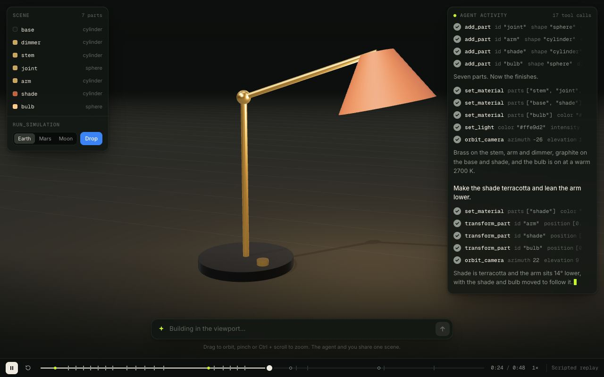

<p align="center">
  
</p>

<p align="center">
  <a href="https://distri.dev/docs/"><b>Docs</b></a> ·
  <a href="https://distri.dev/samples/"><b>Live samples</b></a> ·
  <a href="https://distri.dev/"><b>Website</b></a> ·
  <a href="https://app.distri.dev"><b>Distri Cloud</b></a>
</p>

<p align="center">
  <a href="LICENSE"></a>
  <a href="https://github.com/distrihub/distri/releases"></a>
  
  
</p>

<h3 align="center">The agent runs on Distri. Its tools run in your app.</h3>

<p align="center">
Coding agents have transformed the software industry.<br>
Distri brings those agentic capabilities, embedded directly in your product.
</p>

<br>

<table>
  <tr>
    <td width="50%"><a href="https://distri.dev/samples/?id=kyb-onboarding"></a></td>
    <td width="50%"><a href="https://distri.dev/samples/?id=checkout"></a></td>
  </tr>
  <tr>
    <td align="center"><b>KYC / KYB</b><br>Reads two documents and fills the whole form.</td>
    <td align="center"><b>Checkout</b><br>One sentence becomes a cart, a discount and a ready-to-pay sheet.</td>
  </tr>
  <tr>
    <td><a href="https://distri.dev/samples/?id=design-canvas"></a></td>
    <td><a href="https://distri.dev/samples/?id=3d-studio"></a></td>
  </tr>
  <tr>
    <td align="center"><b>Design canvas</b><br>Lays out two mobile screens, then restyles them.</td>
    <td align="center"><b>3D studio</b><br>Builds a model part by part in WebGL.</td>
  </tr>
</table>

<p align="center"><a href="https://distri.dev/samples/"><b>Play them live →</b></a></p>

## How it works

<p align="center">
  
</p>

- **An agent is a markdown file:** instructions, a model and a list of tools.
- **A tool is a function your app already has,** like `cart.add` or `form.setValues`.
- **When the agent calls it, your handler runs in the user's browser or phone,** in their session. The user sees every step and approves what matters.

## Quick start

```bash
curl -fsSL https://distri.dev/install.sh | sh
```

**1. Write the agent and push it**

```markdown
---
name = "shop_assistant"
description = "Helps shoppers check out"

[tools]
external = ["add_to_cart"]

[model_settings]
model = "gpt-4.1-mini"
---

# ROLE
You help shoppers on our store.
```

```bash
distri login
distri push
```

**2. Hand it your functions**

```tsx
import { DistriProvider, Chat } from '@distri/react';
import type { DistriFnTool } from '@distri/core';

const addToCart: DistriFnTool = {
  name: 'add_to_cart',
  description: 'Add a product to the cart',
  type: 'function',
  parameters: { type: 'object', properties: { sku: { type: 'string' } }, required: ['sku'] },
  autoExecute: true,
  handler: async ({ sku }) => {
    await cart.add(sku); // your code, in the browser
    return { ok: true, items: cart.count };
  },
};

<DistriProvider config={{ baseUrl: 'https://api.distri.dev/v1', clientId: 'dpc_…', workspaceId: '…' }}>
  <Chat agentId="shop_assistant" externalTools={[addToCart]} />
</DistriProvider>
```

**3. Ask it something**

> Add two oat milks to my cart

The agent calls `add_to_cart`, your handler runs, and the cart on screen changes the way it does for a click.

Full guide: [in-product tools](https://distri.dev/docs/guides/agent/in-product-tools/). The SDKs for React, React Native and Angular live in [distrihub/distrijs](https://github.com/distrihub/distrijs).

## Everything an embedded agent needs, built in

<p align="center">
  
</p>

| | |
|---|---|
| **Embedded** | Auth handshake, client-side tools, and approvals in your own UI. For web, mobile, or any page with one script tag. |
| **Runtime** | Durable runs, workflows, sub-agents, schedules, webhooks and steps that wait for a person. |
| **Agents** | Agents as markdown, skills, templates, threads, sessions and end users. |
| **Protocols and tools** | [A2A](https://google.github.io/a2a/) for every agent, MCP for tools, HTTP tools, OAuth connections and secrets. |
| **AI Gateway** | Multi-provider connectivity, cost attribution per agent and end user, limits and budgets, OpenTelemetry traces. |
| **Channels** | The same agent on Slack, Telegram, WhatsApp and Discord, or from your backend over the API. |

## Run it

**Distri Cloud** is the fastest way to start: [app.distri.dev](https://app.distri.dev).

**Self-host** with one command. It starts the server and the web UI:

```bash
distri serve            # http://localhost:7777
```

**Models.** Set the model per agent, on your own keys: OpenAI, Anthropic, or any OpenAI-compatible endpoint.

<details>
<summary><b>CLI reference</b></summary>

```bash
distri                                   # interactive TUI
distri tui my_agent                      # chat with one agent
distri run --agent my_agent --task "…"   # run a single task

distri push                              # sync agents, skills and templates
distri push --dry-run                    # preview what would upload
distri agents list
distri skills list
distri traces list                       # inspect runs
distri secrets list
distri connections list

distri update                            # pull the latest server and UI
distri version
```

</details>

<details>
<summary>Other install options</summary>

**Direct download:**
```bash
# darwin-arm64 | darwin-x86_64 | linux-arm64 | linux-x86_64
TARGET=darwin-arm64
curl -L "https://github.com/distrihub/distri/releases/latest/download/distri-${TARGET}.tar.gz" -o distri.tar.gz
sudo tar -xzf distri.tar.gz -C /usr/local/bin distri
```

**Windows (PowerShell):**
```powershell
Invoke-WebRequest https://github.com/distrihub/distri/releases/latest/download/distri-windows-x86_64.zip -OutFile distri.zip
Expand-Archive distri.zip -DestinationPath $Env:LOCALAPPDATA\distri -Force
$Env:Path += ";$Env:LOCALAPPDATA\distri"
```
</details>

<details>
<summary><b>Repository layout</b></summary>

```
distri/
├── distri-types/          # Shared types (agent config, events, stores, tools)
├── distri-cli/            # The `distri` command
├── distri/                # Rust client library (A2A)
├── distri-a2a/            # A2A protocol types
├── distri-workflow/       # Workflow definitions
├── distri-tool/           # TypeScript script-tool contract (Deno)
└── server/
    ├── distri-core/       # Agent loop, tools, model clients
    ├── distri-server/     # HTTP server (actix-web, A2A endpoints)
    ├── distri-stores/     # SQLite and Postgres stores
    ├── distri-auth/       # Auth and OAuth connections
    ├── distri-filesystem/ # File and artifact tools
    ├── llm-gateway/       # Provider clients
    └── agents/            # Built-in agent definitions
```

```bash
cargo build
cargo test
```

</details>

## License

[MIT](LICENSE)
