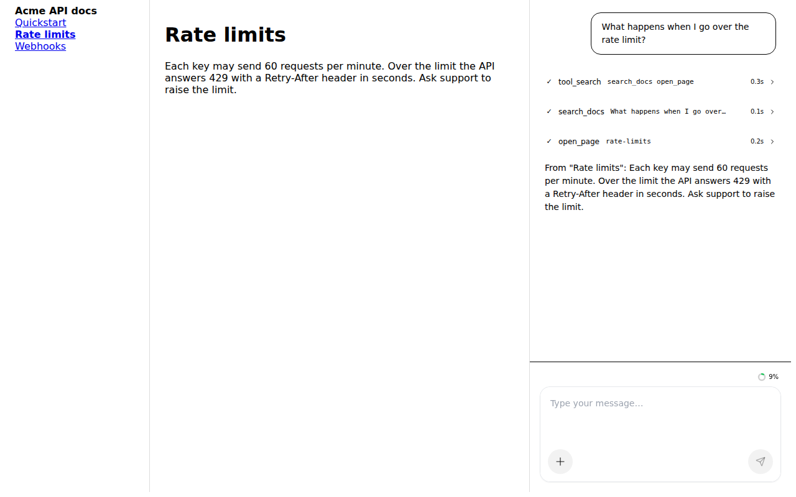

# Docs agent on a React portal

> **"Add a docs agent to my React developer portal that answers questions from our docs pages and opens the page it used."**

A React portal ([`app/`](app)) with the distri chat beside the docs. The agent's two tools run in the reader's browser:

| Tool | Runs in | Does |
|---|---|---|
| `search_docs` | the page | Searches the portal's own pages (`app/src/docs.ts`) and returns the matching ones |
| `open_page` | the page | Switches the portal to the page the answer came from |

The agent (`docs_agent`) answers only from what `search_docs` returns, then opens that page.

## Run it

```bash
distri login
distri apply samples/docs-agent --set site_url=http://localhost:5302
cd samples/docs-agent/app
npm install
echo "DISTRI_API_KEY=<your key>" > .env
npx vite
```

Open http://localhost:5302 and ask "What happens when I go over the rate limit?". The agent calls `search_docs`, then `open_page`, and the portal switches to **Rate limits**:



## How the page talks to distri

- [`app/server/distri-token.ts`](app/server/distri-token.ts): the dev server exchanges `DISTRI_API_KEY` for a short-lived token (`POST /v1/token`). The key never reaches the browser. In production, put that exchange in your backend.
- [`app/src/main.tsx`](app/src/main.tsx): `<DistriProvider>` takes the token, and `<Chat agentId="docs_agent" externalTools={tools} />` renders the chat. The two tools set `autoExecute: true` because they only read the docs and switch pages. Leave it off for tools that change data, and the reader confirms each call.

To use it on your portal, replace `DOCS` in `app/src/docs.ts` with your pages, or make `search_docs` call your search.

## Test

`DISTRI_URL=… DISTRI_API_KEY=… test/run.sh` applies the folder, starts the portal, asks the question in Chromium (Playwright), and saves `test/out/1-portal.png`, `test/out/2-answered.png` and the transcript.
